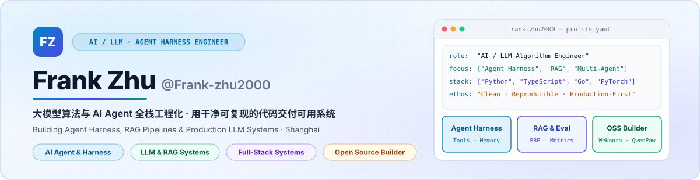

  <a href="https://github.com/Frank-zhu2000">
    <picture>
      <source media="(prefers-color-scheme: dark)" srcset="./assets/banner-dark.svg" />
      <source media="(prefers-color-scheme: light)" srcset="./assets/banner-light.svg" />
      
    </picture>
  </a>

  

    
    
    <!-- OSS_BADGE:START --><!-- OSS_BADGE:END -->
    
    
  

---

### 👨‍💻 关于我 · About Me

- 🔭 **专注方向**：AI 工程师 / 大模型算法工程师，深耕 **AI Agent**、**Agent Harness**、**RAG 管线**与全栈工程化落地。
- 🎓 **学术背景**：电子工程（EE）专业**硕士研究生**，研究方向涵盖 **人工智能、CV、NLP 与多模态（Multimodal）**，具备多项算法项目实战、算法竞赛与学术论文研究经历。
- 🧠 **技术聚焦**：专注于工具调用（Tool Use / MCP）、上下文与记忆管理、多 Agent 协作编排、混合检索与系统级评测。
- 🤝 **开源贡献**：持续向 **腾讯、阿里、清华、港大** 等头部企业与高校实验室开源项目贡献核心修复与工程改进，累计 <!-- ABOUT_OSS_STAT:START -->**57 个已合并 PR · 16 个仓库 · 788k+ Stars 生态**<!-- ABOUT_OSS_STAT:END -->。 <!-- ORG_BADGES:START -->   <!-- ORG_BADGES:END -->
- 📫 **交流协作**：欢迎就 Agent 架构、Harness 工程与大模型生产化落地展开交流，也欢迎通过 Issue / PR 联系！

---

### 🏆 核心项目 · Featured Projects

<table width="100%">
  <tr>
    <td width="50%" valign="top">
      <h4>📘 <a href="https://github.com/Frank-zhu2000/repo-mastery-html">repo-mastery-html</a></h4>
      

        
        
        
      

      
把任意 GitHub 开源仓库一键转化为<strong>「0 基础到精通」离线单文件 HTML 互动学习系统</strong>，让源码拆解即开即学。

      <ul>
        <li><strong>三大交互蓝图</strong>：全链路数据流、技术架构边界与业务泳道图联动定位</li>
        <li><strong>沉浸学习工坊</strong>：痛点类比 + I/O 真实数据契约 + <strong>100% 逐行中文源码精注</strong></li>
        <li><strong>工程化验收</strong>：单文件零依赖输出 · Headless CDP 零溢出自动校验</li>
      </ul>
      

        <a href="https://frank-zhu2000.github.io/repo-mastery-html/">🌐 <b>在线 Demo (WeKnora)</b></a> ·
        <a href="https://github.com/Frank-zhu2000/repo-mastery-html">📦 <b>查看仓库</b></a>
      

    </td>
    <td width="50%" valign="top">
      <h4>⚡ <a href="https://github.com/Frank-zhu2000/ragforge">ragforge</a></h4>
      

        
        
        
      

      
轻量、高性能且模块化的 Python <strong>RAG 数据管线工具包</strong>，聚焦可复现的语义分块、混合检索与量化评测。

      <ul>
        <li><strong>零臃肿核心</strong>：仅依赖 Python 标准库，无重型框架锁定、极速启动</li>
        <li><strong>上下文感知分块</strong>：支持 Markdown 标题面包屑与代码函数/类边界切分</li>
        <li><strong>混合检索与评测</strong>：Okapi BM25 + 向量 RRF 融合 · Hit Rate / MRR / NDCG / Faithfulness + CLI</li>
      </ul>
      

        <a href="https://github.com/Frank-zhu2000/ragforge">📦 <b>查看仓库</b></a> ·
        <a href="https://github.com/Frank-zhu2000/ragforge#readme">📖 <b>文档与架构</b></a>
      

    </td>
  </tr>
</table>

---

### 🤝 开源贡献 · Open Source Contributions

<!-- CONTRIBUTIONS:START -->
> 累计向 **腾讯（Tencent）**、**阿里（Alibaba / AgentScope）**、**清华大学（THU-MAIC）**、**香港大学（HKUDS）** 等知名企业、高校实验室与高星开源社区贡献 **57** 个已合并 PR，覆盖 **16** 个开源项目，上游生态累计 **788k+ Stars** · 每日由 GitHub Actions 自动同步。

| 仓库 | ⭐ Stars | 已合并 PR | 代表 PR |
| :--- | :---: | :---: | :--- |
|  [affaan-m/ECC](https://github.com/affaan-m/ECC) | 310.4k | 2 | [#3157 fix(gateguard): ignore heredoc prose for tee and path-qualified sinks](https://github.com/affaan-m/ECC/pull/3157) |
|  [HKUDS/DeepTutor](https://github.com/HKUDS/DeepTutor)  | 62.5k | 2 | [#2127 fix(web): keep the composer resources popover inside the viewport](https://github.com/HKUDS/DeepTutor/pull/2127) |
|  [alibaba/open-code-review](https://github.com/alibaba/open-code-review)  | 56.2k | 4 | [#1766 fix(action): show warnings in zero-finding PR summaries](https://github.com/alibaba/open-code-review/pull/1766) |
|  [JustVugg/colibri](https://github.com/JustVugg/colibri) | 53.4k | 3 | [#1622 fix(v4): use direct reads for per_matrix REAP expert records](https://github.com/JustVugg/colibri/pull/1622) |
|  [HKUDS/nanobot](https://github.com/HKUDS/nanobot)  | 50.3k | 1 | [#5873 refactor(utils): dedupe atomic JSONL write helper](https://github.com/HKUDS/nanobot/pull/5873) |
|  [zhayujie/CowAgent](https://github.com/zhayujie/CowAgent) | 48.1k | 3 | [#3680 docs: document COW_DATA_DIR and cow-data volume for Docker upgrades](https://github.com/zhayujie/CowAgent/pull/3680) |
|  [THU-MAIC/OpenMAIC](https://github.com/THU-MAIC/OpenMAIC)  | 44.4k | 16 | [#2016 fix(export): keep long PPTX formulas on one line](https://github.com/THU-MAIC/OpenMAIC/pull/2016) |
|  [HKUDS/Vibe-Trading](https://github.com/HKUDS/Vibe-Trading)  | 38.8k | 1 | [#1812 fix(futu): stop profiles from pinning the HK trade market](https://github.com/HKUDS/Vibe-Trading/pull/1812) |
|  [Tencent/WeKnora](https://github.com/Tencent/WeKnora)  | 38.2k | 7 | [#4719 fix(chat): keep distinct facts in partial-overlap dedup](https://github.com/Tencent/WeKnora/pull/4719) |
|  [agentscope-ai/QwenPaw](https://github.com/agentscope-ai/QwenPaw)  | 38.2k | 3 | [#8514 fix(desktop): bundle visual_compression glyph atlas assets](https://github.com/agentscope-ai/QwenPaw/pull/8514) |
|  [1Panel-dev/MaxKB](https://github.com/1Panel-dev/MaxKB) | 23.2k | 1 | [#7086 fix: MCP node should not mark all params required when schema has no required](https://github.com/1Panel-dev/MaxKB/pull/7086) |
|  [vastsa/PI-Desktop](https://github.com/vastsa/PI-Desktop) | 8.2k | 5 | [#1764 fix(agent-runtime): discover native sessions in configured sessionDir](https://github.com/vastsa/PI-Desktop/pull/1764) |
|  [Tencent/teamai-cli](https://github.com/Tencent/teamai-cli)  | 5.9k | 2 | [#1042 feat: add teamai.yaml language for English agent texts (#1014)](https://github.com/Tencent/teamai-cli/pull/1042) |
|  [melgarafael/DeskcommCRM](https://github.com/melgarafael/DeskcommCRM) | 5.5k | 2 | [#2781 fix(ia): preço do Gemini 3.6/3.7/3.8 Flash dobra em 2027-01-01 (#2563)](https://github.com/melgarafael/DeskcommCRM/pull/2781) |
|  [spacering-net/codeg](https://github.com/spacering-net/codeg) | 4.6k | 4 | [#945 fix(work-task): fail an empty end_turn that reported an agent error](https://github.com/spacering-net/codeg/pull/945) |
|  [techflag/workdsh](https://github.com/techflag/workdsh) | 344 | 1 | [#68 fix(experts): share one agents home for publish and execution](https://github.com/techflag/workdsh/pull/68) |

📂 展开查看全部已合并 PR 完整明细（32 条实时记录 + 12 条历史归档代表记录）

#### 近期实时已合并 PR（32 条）

| 合并日期 | 仓库 | PR |
| :---: | :--- | :--- |
| 2026-11-13 |  [alibaba/open-code-review](https://github.com/alibaba/open-code-review)  | [#1766 fix(action): show warnings in zero-finding PR summaries](https://github.com/alibaba/open-code-review/pull/1766) |
| 2026-11-03 |  [agentscope-ai/QwenPaw](https://github.com/agentscope-ai/QwenPaw)  | [#8514 fix(desktop): bundle visual_compression glyph atlas assets](https://github.com/agentscope-ai/QwenPaw/pull/8514) |
| 2026-11-03 |  [alibaba/open-code-review](https://github.com/alibaba/open-code-review)  | [#1837 fix(diff): keep tracked gitignored files in workspace review](https://github.com/alibaba/open-code-review/pull/1837) |
| 2026-10-31 |  [HKUDS/DeepTutor](https://github.com/HKUDS/DeepTutor)  | [#2127 fix(web): keep the composer resources popover inside the viewport](https://github.com/HKUDS/DeepTutor/pull/2127) |
| 2026-10-30 |  [THU-MAIC/OpenMAIC](https://github.com/THU-MAIC/OpenMAIC)  | [#2016 fix(export): keep long PPTX formulas on one line](https://github.com/THU-MAIC/OpenMAIC/pull/2016) |
| 2026-10-28 |  [agentscope-ai/QwenPaw](https://github.com/agentscope-ai/QwenPaw)  | [#8438 fix(mail): do not append domain when account name is already a full address](https://github.com/agentscope-ai/QwenPaw/pull/8438) |
| 2026-10-28 |  [HKUDS/DeepTutor](https://github.com/HKUDS/DeepTutor)  | [#2121 fix(web): follow the OS theme by default and add a System option](https://github.com/HKUDS/DeepTutor/pull/2121) |
| 2026-10-28 |  [THU-MAIC/OpenMAIC](https://github.com/THU-MAIC/OpenMAIC)  | [#2061 fix(workbench): delete one character of a partial skill handle](https://github.com/THU-MAIC/OpenMAIC/pull/2061) |
| 2026-10-28 |  [THU-MAIC/OpenMAIC](https://github.com/THU-MAIC/OpenMAIC)  | [#2022 fix(models): resolve Ark Agent Plan model metadata through catalog aliases](https://github.com/THU-MAIC/OpenMAIC/pull/2022) |
| 2026-10-28 |  [THU-MAIC/OpenMAIC](https://github.com/THU-MAIC/OpenMAIC)  | [#2021 fix(narration): keep Greek letters like π as symbols in captions](https://github.com/THU-MAIC/OpenMAIC/pull/2021) |
| 2026-10-28 |  [THU-MAIC/OpenMAIC](https://github.com/THU-MAIC/OpenMAIC)  | [#2018 fix(editor): keep inline formulas when legacy canvas text is edited](https://github.com/THU-MAIC/OpenMAIC/pull/2018) |
| 2026-10-27 |  [THU-MAIC/OpenMAIC](https://github.com/THU-MAIC/OpenMAIC)  | [#2027 fix(agent-runtime): keep the system prompt stable when materials change (AI-assisted)](https://github.com/THU-MAIC/OpenMAIC/pull/2027) |
| 2026-10-26 |  [agentscope-ai/QwenPaw](https://github.com/agentscope-ai/QwenPaw)  | [#8362 fix(console): scope chat input drafts to the conversation](https://github.com/agentscope-ai/QwenPaw/pull/8362) |
| 2026-10-26 |  [Tencent/WeKnora](https://github.com/Tencent/WeKnora)  | [#4719 fix(chat): keep distinct facts in partial-overlap dedup](https://github.com/Tencent/WeKnora/pull/4719) |
| 2026-10-26 |  [THU-MAIC/OpenMAIC](https://github.com/THU-MAIC/OpenMAIC)  | [#1983 fix(agent): cap parallel generate_tts calls and keep failure reasons](https://github.com/THU-MAIC/OpenMAIC/pull/1983) |
| 2026-10-23 |  [Tencent/WeKnora](https://github.com/Tencent/WeKnora)  | [#4573 fix(docparser): treat anydoc resource limits as permanent parse failures](https://github.com/Tencent/WeKnora/pull/4573) |
| 2026-10-21 |  [Tencent/WeKnora](https://github.com/Tencent/WeKnora)  | [#4561 fix(db): stop logging bound parameters in GORM slow-query logs](https://github.com/Tencent/WeKnora/pull/4561) |
| 2026-10-20 |  [vastsa/PI-Desktop](https://github.com/vastsa/PI-Desktop) | [#1764 fix(agent-runtime): discover native sessions in configured sessionDir](https://github.com/vastsa/PI-Desktop/pull/1764) |
| 2026-10-19 |  [THU-MAIC/OpenMAIC](https://github.com/THU-MAIC/OpenMAIC)  | [#1908 fix(agents): match generated agent voices to catalogue gender (#1084)](https://github.com/THU-MAIC/OpenMAIC/pull/1908) |
| 2026-10-19 |  [vastsa/PI-Desktop](https://github.com/vastsa/PI-Desktop) | [#1739 fix(plugins): allow relative paths inside a drive-root workspace](https://github.com/vastsa/PI-Desktop/pull/1739) |
| 2026-10-19 |  [alibaba/open-code-review](https://github.com/alibaba/open-code-review)  | [#1721 docs(contributing): refresh Project Structure tree (#1441)](https://github.com/alibaba/open-code-review/pull/1721) |
| 2026-10-18 |  [techflag/workdsh](https://github.com/techflag/workdsh) | [#68 fix(experts): share one agents home for publish and execution](https://github.com/techflag/workdsh/pull/68) |
| 2026-10-17 |  [Tencent/WeKnora](https://github.com/Tencent/WeKnora)  | [#4432 fix(agent): share one configurable budget for web_fetch](https://github.com/Tencent/WeKnora/pull/4432) |
| 2026-10-14 |  [THU-MAIC/OpenMAIC](https://github.com/THU-MAIC/OpenMAIC)  | [#1893 fix(pi): reject null storeState.scenes members with 400 (#1821)](https://github.com/THU-MAIC/OpenMAIC/pull/1893) |
| 2026-10-14 |  [spacering-net/codeg](https://github.com/spacering-net/codeg) | [#945 fix(work-task): fail an empty end_turn that reported an agent error](https://github.com/spacering-net/codeg/pull/945) |
| 2026-10-13 |  [Tencent/WeKnora](https://github.com/Tencent/WeKnora)  | [#4208 fix(docs): prebundle fastdom when mermaid imports it (#2899)](https://github.com/Tencent/WeKnora/pull/4208) |
| 2026-10-13 |  [HKUDS/Vibe-Trading](https://github.com/HKUDS/Vibe-Trading)  | [#1812 fix(futu): stop profiles from pinning the HK trade market](https://github.com/HKUDS/Vibe-Trading/pull/1812) |
| 2026-10-13 |  [spacering-net/codeg](https://github.com/spacering-net/codeg) | [#926 fix(acp): stop empty check_user_feedback calls from looping](https://github.com/spacering-net/codeg/pull/926) |
| 2026-10-12 |  [zhayujie/CowAgent](https://github.com/zhayujie/CowAgent) | [#3680 docs: document COW_DATA_DIR and cow-data volume for Docker upgrades](https://github.com/zhayujie/CowAgent/pull/3680) |
| 2026-10-12 |  [melgarafael/DeskcommCRM](https://github.com/melgarafael/DeskcommCRM) | [#2781 fix(ia): preço do Gemini 3.6/3.7/3.8 Flash dobra em 2027-01-01 (#2563)](https://github.com/melgarafael/DeskcommCRM/pull/2781) |
| 2026-10-12 |  [vastsa/PI-Desktop](https://github.com/vastsa/PI-Desktop) | [#1577 fix(asktool): scroll long question prompts inside the card (#1531)](https://github.com/vastsa/PI-Desktop/pull/1577) |
| 2026-10-12 |  [Tencent/teamai-cli](https://github.com/Tencent/teamai-cli)  | [#1042 feat: add teamai.yaml language for English agent texts (#1014)](https://github.com/Tencent/teamai-cli/pull/1042) |

#### 早期历史归档代表记录（25 PR · 12 仓库）

| 仓库 | ⭐ Stars | 历史合并数 | 代表 PR |
| :--- | :---: | :---: | :--- |
|  [affaan-m/ECC](https://github.com/affaan-m/ECC) | 310.4k | 2 | [#3157 fix(gateguard): ignore heredoc prose for tee and path-qualified sinks](https://github.com/affaan-m/ECC/pull/3157) |
|  [alibaba/open-code-review](https://github.com/alibaba/open-code-review)  | 56.2k | 1 | [#1449 docs(assurance): correct API key storage claims](https://github.com/alibaba/open-code-review/pull/1449) |
|  [JustVugg/colibri](https://github.com/JustVugg/colibri) | 53.4k | 3 | [#1622 fix(v4): use direct reads for per_matrix REAP expert records](https://github.com/JustVugg/colibri/pull/1622) |
|  [HKUDS/nanobot](https://github.com/HKUDS/nanobot)  | 50.3k | 1 | [#5873 refactor(utils): dedupe atomic JSONL write helper](https://github.com/HKUDS/nanobot/pull/5873) |
|  [zhayujie/CowAgent](https://github.com/zhayujie/CowAgent) | 48.1k | 2 | [#3199 fix: check token budget before turn-count trim](https://github.com/zhayujie/CowAgent/pull/3199) |
|  [THU-MAIC/OpenMAIC](https://github.com/THU-MAIC/OpenMAIC)  | 44.4k | 7 | [#1651 fix(generation): reject invalid quiz option shapes and constrain values at the source](https://github.com/THU-MAIC/OpenMAIC/pull/1651) |
|  [Tencent/WeKnora](https://github.com/Tencent/WeKnora)  | 38.2k | 2 | [#3531 docs(ollama): document embedding model config and RAM guidance](https://github.com/Tencent/WeKnora/pull/3531) |
|  [1Panel-dev/MaxKB](https://github.com/1Panel-dev/MaxKB) | 23.2k | 1 | [#7086 fix: MCP node should not mark all params required when schema has no required](https://github.com/1Panel-dev/MaxKB/pull/7086) |
|  [vastsa/PI-Desktop](https://github.com/vastsa/PI-Desktop) | 8.2k | 2 | [#632 fix(host-core): detect MSIX Store pwsh app-execution aliases](https://github.com/vastsa/PI-Desktop/pull/632) |
|  [Tencent/teamai-cli](https://github.com/Tencent/teamai-cli)  | 5.9k | 1 | [#626 docs: fix CONTRIBUTING branch baseline and dogfood setup](https://github.com/Tencent/teamai-cli/pull/626) |
|  [melgarafael/DeskcommCRM](https://github.com/melgarafael/DeskcommCRM) | 5.5k | 1 | [#1288 fix(migrations): align MANIFEST timestamp for 0238 with filename](https://github.com/melgarafael/DeskcommCRM/pull/1288) |
|  [spacering-net/codeg](https://github.com/spacering-net/codeg) | 4.6k | 2 | [#778 fix(acp): update session transcript pointer after /clear](https://github.com/spacering-net/codeg/pull/778) |

🔄 展开查看评审中 Open PR（15 条 · 覆盖 10 个仓库，合入后自动晋升至主表）

| 仓库 | ⭐ Stars | 提交日期 | PR |
| :--- | :---: | :---: | :--- |
|  [NousResearch/hermes-agent](https://github.com/NousResearch/hermes-agent) | 266.0k | 2026-10-18 | [#140813 fix(agent): accept reasoning effort max on Muse Spark 1.3](https://github.com/NousResearch/hermes-agent/pull/140813) |
|  [langgenius/dify](https://github.com/langgenius/dify) | 161.9k | 2026-10-28 | [#44927 fix(api): keep saved answer when provider last_used update fails](https://github.com/langgenius/dify/pull/44927) |
|  [HKUDS/CLI-Anything](https://github.com/HKUDS/CLI-Anything)  | 65.2k | 2026-10-17 | [#580 fix(freecad): correct primitive center-of-mass](https://github.com/HKUDS/CLI-Anything/pull/580) |
|  [alibaba/open-code-review](https://github.com/alibaba/open-code-review)  | 56.2k | 2026-10-16 | [#1757 fix(viewer): show a live review as running instead of aborted](https://github.com/alibaba/open-code-review/pull/1757) |
|  [HKUDS/nanobot](https://github.com/HKUDS/nanobot)  | 50.3k | 2026-10-11 | [#6163 fix(channels): deliver provider retry waits through an opt-in hook](https://github.com/HKUDS/nanobot/pull/6163) |
|  [Tencent/WeKnora](https://github.com/Tencent/WeKnora)  | 38.2k | 2026-10-12 | [#4183 fix: allow bootstrap admin signup when registration is closed](https://github.com/Tencent/WeKnora/pull/4183) |
|  [agentscope-ai/QwenPaw](https://github.com/agentscope-ai/QwenPaw)  | 38.2k | 2026-10-27 | [#8445 fix(mcp): fall back when discover returns HTTP 404 and -32601](https://github.com/agentscope-ai/QwenPaw/pull/8445) |
|  [agentscope-ai/QwenPaw](https://github.com/agentscope-ai/QwenPaw)  | 38.2k | 2026-10-22 | [#8389 fix(app): read QWENPAW_CORS_ORIGINS at runtime](https://github.com/agentscope-ai/QwenPaw/pull/8389) |
|  [agentscope-ai/QwenPaw](https://github.com/agentscope-ai/QwenPaw)  | 38.2k | 2026-10-22 | [#8384 fix(hub): reach Docker runtimes when the Hub runs in a container](https://github.com/agentscope-ai/QwenPaw/pull/8384) |
|  [agentscope-ai/agentscope](https://github.com/agentscope-ai/agentscope)  | 36.7k | 2026-10-28 | [#3539 fix(tool): stop reusing deleted task ids](https://github.com/agentscope-ai/agentscope/pull/3539) |
|  [TencentCloud/TencentDB-Agent-Memory](https://github.com/TencentCloud/TencentDB-Agent-Memory)  | 31.2k | 2026-10-20 | [#1748 fix(memory-core): restore per-agent agentId in the OpenClaw plugin](https://github.com/TencentCloud/TencentDB-Agent-Memory/pull/1748) |
|  [TencentCloud/TencentDB-Agent-Memory](https://github.com/TencentCloud/TencentDB-Agent-Memory)  | 31.2k | 2026-10-16 | [#1669 fix(deploy): preserve memory-core gateway config across restarts](https://github.com/TencentCloud/TencentDB-Agent-Memory/pull/1669) |
|  [spacering-net/codeg](https://github.com/spacering-net/codeg) | 4.6k | 2026-10-12 | [#932 fix(delegation): replay the stored task and reopen a custom session with no agent turn](https://github.com/spacering-net/codeg/pull/932) |
|  [spacering-net/codeg](https://github.com/spacering-net/codeg) | 4.6k | 2026-10-11 | [#922 fix(appearance): apply the editor monospace font to conversation code blocks](https://github.com/spacering-net/codeg/pull/922) |
|  [spacering-net/codeg](https://github.com/spacering-net/codeg) | 4.6k | 2026-10-11 | [#920 fix(acp): drop an inherited CODEX_PATH so Codex uses its bundled CLI](https://github.com/spacering-net/codeg/pull/920) |

<!-- CONTRIBUTIONS:END -->

---

### 🛠️ 技术栈 · Tech Stack

| 领域 | 核心技术与工具 |
| :--- | :--- |
| **AI / LLM & Agent** |           |
| **Full-Stack & Systems** |      |
| **Infra & Engineering** |      |

---

### 📊 活跃度与提交热力 · Activity & Stats

  <picture>
    <source media="(prefers-color-scheme: dark)" srcset="https://raw.githubusercontent.com/Frank-zhu2000/Frank-zhu2000/output/github-contribution-grid-snake-dark.svg" />
    <source media="(prefers-color-scheme: light)" srcset="https://raw.githubusercontent.com/Frank-zhu2000/Frank-zhu2000/output/github-contribution-grid-snake.svg" />
    
  </picture>

   

  <picture>
    <source media="(prefers-color-scheme: dark)" srcset="https://github-readme-streak-stats.herokuapp.com/?user=Frank-zhu2000&hide_border=true&background=0D1117&ring=38BDF8&fire=38BDF8&currStreakLabel=38BDF8&sideLabels=CBD5E1&currStreakNum=F1F5F9&sideNums=E2E8F0&dates=94A3B8&stroke=1E3154" />
    <source media="(prefers-color-scheme: light)" srcset="https://github-readme-streak-stats.herokuapp.com/?user=Frank-zhu2000&hide_border=true&background=FFFFFF&ring=0284C7&fire=0284C7&currStreakLabel=0284C7&sideLabels=334155&currStreakNum=0F172A&sideNums=1E293B&dates=64748B&stroke=DCE4F0" />
    
  </picture>

---

  Build clean, reproducible AI systems · <a href="https://github.com/Frank-zhu2000">github.com/Frank-zhu2000</a>

